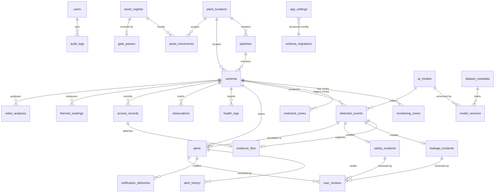
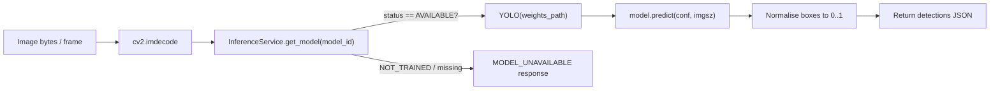
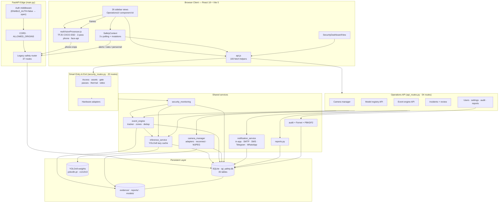
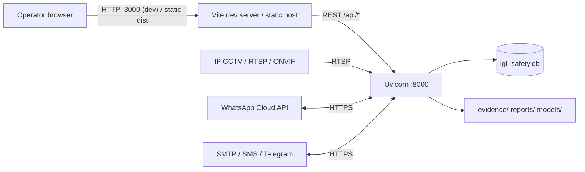

# IGL VisionGuard AI — Complete System Architecture Report

**Document type:** Read-only architecture inspection
**Snapshot date:** 22 November 2026
**Repository:** `C:\Users\Krishna Sharma\Desktop\IGL`
**Backend version:** FastAPI app `1.1.0`
**Frontend version:** `igl-visionguard-ai` `1.0.0`

> This report describes the code exactly as found during inspection. No project files were modified.
> Credentials, tokens and password hashes are intentionally **not** reproduced anywhere in this document.

---

## 0. Executive Summary

IGL VisionGuard AI is a **single-plant, browser-rendered industrial safety and security platform** with a FastAPI + SQLite backend.

| Dimension | Current state |
|---|---|
| Backend HTTP routes | **111** across three routers (`main.py` 37, `api_routes.py` 54, `security_routes.py` 20) |
| Frontend sidebar destinations | **26** |
| React view files | **27** (26 wired, 1 orphaned) |
| Frontend API helper functions | **100** exported from `api.js` |
| Database tables defined in code | **35** (29 currently applied to the live DB file) |
| Registered AI models | **2** in DB now (`yolov8n`, `water-leakage` v3); a 3rd (`thermal-person`) is seeded as `NOT_TRAINED` |
| Authentication | Code exists (JWT-style HMAC tokens, RBAC) but **disabled by default** (`ENABLE_AUTH=false`); login page removed |
| Live data volume | Cameras **0**, alerts **0**, events **0**, evidence **0**, reports **0**, users **1**, audit logs **13** |

**Architectural character:** the system is a *composite* of two generations of code:

1. **Safety generation** — browser-side TensorFlow.js vision (person / phone / helmet / face), SQLite-backed alerts, personnel rules, WhatsApp notifications.
2. **Operations generation** — backend YOLO inference, camera manager (RTSP/webcam/file/image), event engine, evidence files, model registry with versioned weights, reporting, notifications, RBAC, and a new Smart Entry & Exit security module.

The two generations are joined through shared tables (`cameras`, `alerts`, `users`) and shared services (`inference_service`, `event_engine`, `camera_manager`), but **not every path is wired end-to-end**.

---

## 1. Frontend Folder Structure and Sidebar Routes

### 1.1 Folder tree

```
frontend/
├── package.json                # React 18, Vite 5, Tailwind 4, TFJS, coco-ssd, face-api, lucide-react
├── package-lock.json
├── vite.config.js              # dev server port 3000, host: true
├── tailwind.config.js
├── postcss.config.js
├── index.html
├── .env.example                # VITE_API_BASE
├── public/
│   ├── models/face-api/        # tiny_face_detector, face_landmark_68, face_recognition (+ LICENSE)
│   └── plant_schematic.jpg
└── src/
    ├── main.jsx                # React entry point
    ├── App.jsx                 # sidebar-tab router (26 branches)
    ├── index.css               # Tailwind + glass-panel utilities
    ├── components/
    │   ├── Sidebar.jsx         # 26-item navigation
    │   ├── Navbar.jsx          # brand, active camera, clock, online pill
    │   ├── RealInputBanner.jsx # "real input" banner + 5 demo scenario buttons
    │   ├── EvidenceModal.jsx   # evidence snapshot viewer
    │   └── OperationsUI.jsx    # shared PageHeader/Panel/DataTable/StatusBadge/EmptyState/ErrorState/form primitives
    ├── context/
    │   └── SafetyContext.jsx   # global state + 3-second backend polling + all mutation actions
    ├── services/
    │   ├── api.js              # 100 exported fetch helpers (all backend endpoints)
    │   ├── realVisionProcessor.js   # browser CV engine (~46 KB)
    │   ├── phoneDetectionProcessor.js # backend YOLO phone detector wrapper
    │   ├── faceRecognition.js  # face-api load / descriptor / match
    │   └── packagingProcessor.js # bottle inspection simulation
    └── views/                  # 27 screen components (listed in §2)
```

### 1.2 Sidebar routes (exact order as rendered)

| # | id | Label | Icon | Badge logic |
|---|---|---|---|---|
| 1 | `dashboard` | Overview | Home | — |
| 2 | `security` | Smart Entry & Exit | DoorOpen | static `NEW` |
| 3 | `camera-input` | Camera Setup | Camera | `LIVE` when `stats.cameras_online > 0` |
| 4 | `live-monitoring` | Live Monitoring | Tv | — |
| 5 | `expected-personnel` | Expected Personnel | UserCheck | count of `UNKNOWN_PERSON` alerts, else `ALERT` |
| 6 | `packaging` | Packaging Inspection | Boxes | — |
| 7 | `pipe-inspection` | Pipe Inspection & Scanner | Camera | static `AI SCANNER` |
| 8 | `personnel-monitoring` | Personnel Schedule & Monitoring | Users | unresolved personnel events, else `NEW` |
| 9 | `alerts` | Safety Events | ShieldAlert | `stats.active_alerts` |
| 10 | `near-miss` | Near Miss | AlertTriangle | — |
| 11 | `personnel` | Incidents | Flame | — |
| 12 | `analytics` | Analytics | BarChart2 | — |
| 13 | `camera-health` | Camera & AI Health | Activity | — |
| 14 | `camera-management` | Camera Management | Video | — |
| 15 | `camera-setup` | Camera Angle & Zones | Map | — |
| 16 | `leakage` | Water Leakage | Droplets | — |
| 17 | `evidence` | Evidence Gallery | Image | — |
| 18 | `plant` | Plant & Pipelines | Network | — |
| 19 | `models` | AI Models & Datasets | Cpu | — |
| 20 | `reports` | Reports | FileBarChart | — |
| 21 | `notifications` | Notifications | Bell | — |
| 22 | `system-health` | System Health | HeartPulse | — |
| 23 | `audit-logs` | Audit Logs | ScrollText | — |
| 24 | `users` | User Management | Users | — |
| 25 | `config` | Configuration | Settings | — |
| 26 | `settings` | General Settings | Wrench | — |

**Hidden route:** `image-camera-inspection` is handled in `App.jsx` but has no sidebar entry; it renders `PipeInspectionView`.

---

## 2. Every Page and Its React Component

`App.jsx` renders one component per `activeTab` value. The table maps every route to its component and backend dependency.

| Route id | Component | File | Talks to backend? | Purpose |
|---|---|---|---|---|
| `dashboard` | `DashboardView` | `views/DashboardView.jsx` | Indirect (context) | KPI cards, live feed card, quick actions |
| `security` | `SecurityDashboardView` | `views/SecurityDashboardView.jsx` | Yes (8 endpoints) | Smart Entry & Exit: access records, assets, movements, thermal, video analysis, hardware |
| `camera-input` | `CameraInputView` | `views/CameraInputView.jsx` | Indirect (context) | Webcam / RTSP / file / image selection + mirror + frame quality |
| `live-monitoring` | `LiveMonitoringView` | `views/LiveMonitoringView.jsx` | Indirect (context → `/api/alerts`) | Live TFJS detection canvas, tracks, phone escalation, siren, face enrolment |
| `expected-personnel` | `ExpectedPersonnelView` | `views/ExpectedPersonnelView.jsx` | Indirect (context) | Expected headcount rules + WhatsApp alerts + simulator |
| `personnel-monitoring` | `PersonnelMonitoringView` | `views/PersonnelMonitoringView.jsx` | Indirect (context) | Schedule rules CRUD + live count verification events |
| `pipe-inspection` / `image-camera-inspection` | `PipeInspectionView` | `views/PipeInspectionView.jsx` | No (client-side) | Pipe leakage heuristic + AI scanner UI |
| `packaging` | `PackagingInspectionView` | `views/PackagingInspectionView.jsx` | No | Conveyor bottle inspection **simulation** |
| `alerts` | `AlertsView` | `views/AlertsView.jsx` | Indirect (context) | Alert table, filters, acknowledge / resolve, evidence |
| `personnel` | `PersonnelAnomalyView` | `views/PersonnelAnomalyView.jsx` | Yes (`/api/personnel/check-anomaly`) | Anomaly check form + observations |
| `near-miss` | `NearMissView` | `views/NearMissView.jsx` | Indirect (context) | Worker–vehicle distance radar (manual slider) |
| `camera-health` | `CameraHealthView` | `views/CameraHealthView.jsx` | No | Active-stream FPS / brightness / blur + protocol rules |
| `analytics` | `AnalyticsView` | `views/AnalyticsView.jsx` | Yes (`/api/analytics`) | Incident distribution charts |
| `config` | `ConfigurationView` | `views/ConfigurationView.jsx` | Partial (context zone save) | Geofence preview + threshold sliders |
| `camera-management` | `CameraManagementView` | `views/CameraManagementView.jsx` | Yes (7 endpoints) | Register / start / stop / test / delete cameras, open MJPEG stream |
| `camera-setup` | `CameraSetupView` | `views/CameraSetupView.jsx` | Yes (5 endpoints) | Camera angle, frame preview, monitoring zones, model assignment |
| `leakage` | `LeakageView` | `views/LeakageView.jsx` | Yes (4 endpoints) | Leakage incidents + model evaluation + human review |
| `evidence` | `EvidenceView` | `views/EvidenceView.jsx` | Yes (2 endpoints) | Evidence gallery + upload |
| `plant` | `PlantView` | `views/PlantView.jsx` | Yes (4 endpoints) | Plant locations and pipelines |
| `models` | `ModelsView` | `views/ModelsView.jsx` | Yes (6 endpoints) | Model registry, versions, class metrics, datasets, reload |
| `reports` | `ReportsView` | `views/ReportsView.jsx` | Yes (3 endpoints) | Generate and download JSON reports |
| `notifications` | `NotificationsView` | `views/NotificationsView.jsx` | Yes (3 endpoints) | Provider status, test send, delivery log |
| `system-health` | `SystemHealthView` | `views/SystemHealthView.jsx` | Yes (`/api/system/health`) | DB, cameras, models, notifications, storage, auth flag |
| `audit-logs` | `AuditLogView` | `views/AuditLogView.jsx` | Yes (`/api/audit-logs`) | Immutable action log |
| `users` | `UsersView` | `views/UsersView.jsx` | Yes (3 endpoints) | User / role management (create, delete, list) |
| `settings` | `SettingsView` | `views/SettingsView.jsx` | Yes (2 endpoints) | Key/value app settings (secrets filtered server-side) |
| — | `ImageCameraInspectionView` | `views/ImageCameraInspectionView.jsx` | No | **Orphaned**: not imported by `App.jsx` |

---

## 3. Backend Folder Structure and API Routes

### 3.1 Folder tree

```
backend/
├── main.py                 # FastAPI app, auth middleware, legacy safety API (37 routes)
├── api_routes.py           # Operations API: cameras, zones, models, datasets, events,
│                           #   incidents, evidence, notifications, reports, users, settings (54 routes)
├── security_routes.py      # Smart Entry & Exit API (20 routes)
├── security_monitoring.py  # Entry/exit, assets, gate passes, thermal, video analysis service
├── hardware_adapters.py    # RFID / access-control / turnstile / alarm / server / thermal / CCTV adapters
│
├── database.py             # Schema (35 tables), migrations 1–4, seed data, audit helper
├── config.py               # Paths, CORS, auth flags, limits, thresholds
├── security.py             # PBKDF2 hashing, HMAC tokens, RBAC, rate limit, Fernet encryption, audit
│
├── camera_manager.py       # Thread-safe camera lifecycle, reconnect, frame/jpeg access, health
├── video_sources.py        # Webcam / RTSP / ONVIF / file / image / HTTP / mock adapters
├── event_engine.py         # Tracker, zone logic, dedup, evidence capture, incidents, alerts
├── inference_service.py    # Model registry loader + YOLO inference + health
├── notification_service.py # In-app, email (SMTP), SMS, Telegram, WhatsApp fan-out
├── reports.py              # Report period metrics + JSON generation
├── whatsapp_service.py     # Meta WhatsApp Cloud API (mock + live)
├── ai_engine.py            # Frame quality (brightness/blur), point-in-polygon, distance
│
├── leakage_training.py     # Dataset validation, combining, oversampling, training, evaluation
├── evaluate_leakage.py     # Independent test evaluation + sample predictions
├── compare_leakage_models.py # v1/v2/v3 comparison report
├── download_leakage_dataset.py # Roboflow dataset downloader
├── debug_yolo_phone.py     # YOLO phone detection diagnostic CLI
├── test_yolo_api.py        # API smoke test
│
├── models/
│   ├── model-water-leakage/
│   │   ├── v1/best.pt  v2/best.pt  v3/best.pt  weights/best.pt
│   │   ├── args.yaml  results.csv  model_card.json
│   │   ├── comparison_v1.json/mp4  comparison_v2.json/mp4
│   │   └── v3_eval_water_leak_5/6.json/mp4
│   └── video_evaluations/  # annotated evaluation clips
├── data/                   # leakage datasets (prepared / multiclass / multiclass_balanced / multisource)
├── evidence/  reports/  runs/  tests/
├── igl_safety.db
├── yolov8n.pt
└── requirements.txt
```

### 3.2 Router wiring (`main.py`)

```python
app.include_router(api_router, prefix="/api")        # api_routes.py
app.include_router(security_router, prefix="/api")   # security_routes.py
```

A global HTTP middleware enforces bearer tokens **only when `ENABLE_AUTH` is true**. Default is `false`, so all endpoints are currently open.

### 3.3 `main.py` — 37 routes

| Method | Path | Function |
|---|---|---|
| GET | `/` | `read_root` |
| GET | `/api/dashboard/stats` | `get_dashboard_stats` |
| GET / POST | `/api/cameras` | `list_cameras` / `register_camera` |
| PUT | `/api/cameras/{camera_id}/status` | `update_camera_status` |
| POST | `/api/process-frame` | `process_frame` (brightness/blur) |
| POST | `/api/yolo/detect` | `detect_yolo_objects` (PyTorch YOLO) |
| GET / POST | `/api/alerts` | `get_alerts` / `create_alert` |
| PUT | `/api/alerts/{id}/acknowledge` | `acknowledge_alert` |
| PUT | `/api/alerts/{id}/resolve` | `resolve_alert` |
| GET / POST | `/api/observations` | `get_observations` / `record_observation` |
| POST | `/api/personnel/check-anomaly` | `check_personnel_anomaly` |
| GET / POST | `/api/restricted-zones` | `get_restricted_zones` / `create_restricted_zone` |
| GET | `/api/analytics` | `get_analytics` |
| GET / POST | `/api/personnel-monitoring/rules` | list / create |
| PUT / DELETE | `/api/personnel-monitoring/rules/{rule_id}` | update / delete |
| GET / POST | `/api/personnel-monitoring/events` | list / create |
| PUT | `/api/personnel-monitoring/events/{id}/acknowledge` | acknowledge |
| PUT | `/api/personnel-monitoring/events/{id}/resolve` | resolve |
| GET / POST | `/api/expected-personnel/rules` | list / create |
| PUT / DELETE | `/api/expected-personnel/rules/{rule_id}` | update / delete |
| GET | `/api/notifications/whatsapp/status` | status |
| POST | `/api/notifications/whatsapp/test` | test message |
| POST | `/api/notifications/whatsapp/send` | unknown-person alert |
| GET | `/api/notifications/logs` | logs |
| GET / POST | `/api/registered-personnel` | list / create |
| PUT / DELETE | `/api/registered-personnel/{person_id}` | update / delete |

### 3.4 `api_routes.py` — 54 routes

| Group | Endpoints |
|---|---|
| Auth | `POST /auth/login`, `GET /auth/me` |
| Cameras | `GET/DELETE /cameras/{id}`, `POST /cameras/{id}/test`, `GET /cameras/{id}/health`, `POST /cameras/{id}/start`, `POST /cameras/{id}/stop`, `POST /cameras/test-source`, `PUT /cameras/{id}/config`, `GET /cameras/{id}/frame.jpg`, `GET /cameras/{id}/stream.mjpg` |
| Zones | `GET/POST /zones`, `DELETE /zones/{zone_id}` |
| Plant | `GET/POST /plant-locations`, `GET/POST /pipelines` |
| Models | `GET /models`, `GET /models/health`, `GET /models/{id}/versions`, `GET /models/{id}/evaluation`, `GET /models/{id}/health`, `POST /models/{id}/reload`, `POST /models/{id}/detect`, `POST /models/{id}/evaluate-video` |
| Datasets | `GET /datasets`, `POST /datasets/validate`, `POST /datasets/prepare` |
| Events | `GET /events`, `POST /events/process` |
| Incidents | `GET /incidents/leakage`, `PUT /incidents/leakage/{id}/review`, `GET /incidents/safety`, `PUT /incidents/safety/{id}/review` |
| Evidence | `GET /evidence`, `GET /evidence/{id}`, `POST /uploads/evidence` |
| Notifications | `GET /notifications/status`, `POST /notifications/test`, `GET /notifications/deliveries` |
| Reports | `POST /reports`, `GET /reports`, `GET /reports/{id}`, `GET /reports/{id}/download` |
| Governance | `GET /audit-logs`, `GET/POST /users`, `PUT/DELETE /users/{id}`, `GET/PUT /settings`, `GET /system/health` |

### 3.5 `security_routes.py` — 20 routes

| Group | Endpoints |
|---|---|
| Dashboard | `GET /security/dashboard` |
| Access records | `GET/POST /security/access-records`, `PUT /security/access-records/{id}/review` |
| Assets | `GET/POST /security/assets`, `PUT/DELETE /security/assets/{id}`, `GET /security/assets/verify`, `POST /security/assets/{id}/movements`, `GET /security/assets/movements` |
| Gate passes | `GET/POST /security/gate-passes` |
| Thermal | `GET/POST /security/thermal/readings` |
| Video | `POST /security/analyze-video`, `GET /security/video-analyses` |
| Hardware | `GET /security/hardware/status`, `POST /security/hardware/{device_type}/connect` |
| Events | `GET /security/events` |

**Total: 111 routes.**

---

## 4. Frontend-to-Backend API Connections

### 4.1 Transport layer

`frontend/src/services/api.js`:

- Base URL: `import.meta.env.VITE_API_BASE` (fallback `http://127.0.0.1:8000/api`).
- `authFetch(url, options)` — sets JSON content type (except `FormData`), performs `fetch`.
  - **Token logic was removed**; there is no `Authorization` header and no 401 redirect.
- `requestJson(url, options)` — wraps `authFetch`, parses JSON/text, returns `{ok, status, data}`.
- Media URL helpers: `cameraStreamUrl`, `cameraFrameUrl`, `evidenceUrl`, `reportDownloadUrl` — all **without** `?token=`.
- 100 exported functions covering every backend group.

### 4.2 Connection map

| Frontend module | Helper functions | Backend endpoints |
|---|---|---|
| `SafetyContext` (polling every 3 s) | `fetchStats`, `fetchAlerts`, `fetchCameras`, `fetchObservations`, `fetchRestrictedZones`, `fetchPersonnelRulesApi`, `fetchPersonnelEventsApi`, `fetchExpectedPersonnelRulesApi`, `fetchWhatsAppStatusApi`, `fetchNotificationLogsApi`, `fetchRegisteredPersonnelApi` | `/dashboard/stats`, `/alerts`, `/cameras`, `/observations`, `/restricted-zones`, `/personnel-monitoring/*`, `/expected-personnel/rules`, `/notifications/whatsapp/*`, `/notifications/logs`, `/registered-personnel` |
| `SafetyContext` (mutations) | `postAlertApi`, `acknowledgeAlertApi`, `resolveAlertApi`, `recordObservationApi`, `postRestrictedZoneApi`, `createPersonnelRuleApi`, `updatePersonnelRuleApi`, `deletePersonnelRuleApi`, `postPersonnelEventApi`, `acknowledgePersonnelEventApi`, `resolvePersonnelEventApi`, expected-personnel CRUD, `registerPersonnelApi`, `updateRegisteredPersonnelApi`, `deleteRegisteredPersonnelApi`, `registerCameraApi`, `startCameraApi`, `stopCameraApi`, `testWhatsAppAlertApi`, `sendUnknownPersonAlertApi` | corresponding `/api/...` routes |
| `CameraManagementView` | `fetchCameras`, `registerCameraApi`, `startCameraApi`, `stopCameraApi`, `testCameraApi`, `deleteCameraApi`, `cameraStreamUrl` | `/cameras`, `/cameras/{id}/start|stop|test`, `/cameras/{id}/stream.mjpg` |
| `CameraSetupView` | `fetchCameras`, `updateCameraConfigApi`, `fetchZonesApi`, `createZoneApi`, `deleteZoneApi`, `fetchModelsApi`, `cameraFrameUrl` | `/cameras`, `/cameras/{id}/config`, `/zones`, `/models`, `/cameras/{id}/frame.jpg` |
| `ModelsView` | `fetchModelsApi`, `fetchModelHealthApi`, `fetchModelVersionsApi`, `fetchModelEvaluationApi`, `fetchDatasetsApi`, `reloadModelApi` | `/models`, `/models/health`, `/models/{id}/versions`, `/models/{id}/evaluation`, `/datasets`, `/models/{id}/reload` |
| `LeakageView` | `fetchLeakageIncidentsApi`, `fetchModelsApi`, `fetchModelEvaluationApi`, `reviewLeakageIncidentApi` | `/incidents/leakage`, `/models`, `/models/model-water-leakage/evaluation`, `/incidents/leakage/{id}/review` |
| `PlantView` | `fetchPlantLocationsApi`, `createPlantLocationApi`, `fetchPipelinesApi`, `createPipelineApi` | `/plant-locations`, `/pipelines` |
| `EvidenceView` | `fetchEvidenceApi`, `uploadEvidenceApi`, `evidenceUrl` | `/evidence`, `/uploads/evidence`, `/evidence/{id}` |
| `ReportsView` | `fetchReportsApi`, `generateReportApi`, `reportDownloadUrl` | `/reports`, `/reports/{id}/download` |
| `NotificationsView` | `fetchNotificationStatusApi`, `testNotificationsApi`, `fetchNotificationDeliveriesApi` | `/notifications/status`, `/notifications/test`, `/notifications/deliveries` |
| `SystemHealthView` | `fetchSystemHealthApi` | `/system/health` |
| `AuditLogView` | `fetchAuditLogsApi` | `/audit-logs` |
| `UsersView` | `fetchUsersApi`, `createUserApi`, `deleteUserApi` | `/users` |
| `SettingsView` | `fetchSettingsApi`, `updateSettingsApi` | `/settings` |
| `PersonnelAnomalyView` | `checkPersonnelAnomalyApi` | `/personnel/check-anomaly` |
| `AnalyticsView` | `fetchAnalyticsApi` | `/analytics` |
| `SecurityDashboardView` | `fetchSecurityDashboardApi`, `fetchAccessRecordsApi`, `reviewAccessRecordApi`, `fetchAssetsApi`, `createAssetApi`, `fetchAssetMovementsApi`, `fetchThermalReadingsApi`, `fetchVideoAnalysesApi`, `fetchHardwareStatusApi`, `fetchSecurityEventsApi`, `analyzeRecordedVideoApi` | all `/security/*` routes |

### 4.3 Browser-side inference (no HTTP)

`LiveMonitoringView`, `ExpectedPersonnelView`, `PersonnelMonitoringView`, `PipeInspectionView`, `ImageCameraInspectionView`, `CameraInputView` use:

- `realVisionProcessor.js` — COCO-SSD via TFJS, two-pass phone detection, helmet model hook, frame-quality analysis, pipe-leak heuristic, siren.
- `phoneDetectionProcessor.js` — sends upper-body crops to `POST /api/yolo/detect` (PyTorch YOLO).
- `faceRecognition.js` — face-api.js models from `/models/face-api/`.

Only **alerts, observations and personnel events** travel back to the backend; raw frames never leave the browser except phone-detection crops and on-demand evidence snapshots.

### 4.4 Endpoints defined but never called by the UI

| Endpoint | Status |
|---|---|
| `POST /api/events/process` | No frontend caller (`processEventApi` exported, unused) |
| `POST /api/models/{id}/evaluate-video` | No frontend caller |
| `POST /api/models/{id}/detect` | No frontend caller (`detectModelApi` exported, unused) |
| `POST /api/security/access-records` | No UI form (records are created by video analysis) |
| `POST /api/security/gate-passes` | No UI |
| `POST /api/security/assets/{id}/movements` | No UI |
| `POST /api/security/hardware/{type}/connect` | No UI |
| `PUT /api/security/assets/{id}`, `DELETE ...` | No UI |

These are backend-complete but have no screen to trigger them.

---

## 5. Database Tables and Relationships

### 5.1 Table inventory

**35 tables defined in `database.py`:**

| # | Table | Purpose |
|---|---|---|
| 1 | `cameras` | Registered video sources + health metrics + credentials (encrypted) |
| 2 | `restricted_zones` | Legacy polygon geofences (safety generation) |
| 3 | `observations` | Track observations (track_id, bbox, feature vector) |
| 4 | `alerts` | Safety alerts + base64 evidence + lifecycle |
| 5 | `health_logs` | Camera/stream health events |
| 6 | `personnel_monitoring_rules` | Schedule-based headcount rules |
| 7 | `personnel_monitoring_events` | Rule violations with expected/observed counts |
| 8 | `expected_personnel_rules` | Overnight/expected headcount rules + WhatsApp target |
| 9 | `notification_logs` | Legacy WhatsApp log |
| 10 | `registered_personnel` | Employee roster + 128-d face descriptors |
| 11 | `plant_locations` | Plant areas |
| 12 | `pipelines` | Pipelines within a plant location |
| 13 | `monitoring_zones` | Camera zones (MONITORING / RESTRICTED) + model assignment |
| 14 | `ai_models` | Model registry (weights, classes, status, metrics, active version) |
| 15 | `model_versions` | Preserved version history per model |
| 16 | `dataset_metadata` | Dataset provenance, licence, image counts |
| 17 | `detection_events` | Normalised detection events (event engine) |
| 18 | `leakage_incidents` | Leakage incidents awaiting human review |
| 19 | `safety_incidents` | Non-leakage safety incidents |
| 20 | `evidence_files` | Evidence on disk with sha256 + retention |
| 21 | `alert_history` | Alert state-change audit |
| 22 | `notification_deliveries` | Provider delivery attempts |
| 23 | `user_reviews` | Human review decisions (false positive/negative) |
| 24 | `audit_logs` | Actor/action/resource audit trail |
| 25 | `notification_history` | Notification attempts (secondary) |
| 26 | `reports` | Generated reports + metrics snapshot |
| 27 | `users` | Accounts, roles, PBKDF2 password hashes |
| 28 | `app_settings` | Key/value configuration (secrets filtered on write) |
| 29 | `schema_migrations` | Applied migration versions |
| 30 | `asset_register` | Company asset register (RFID / barcode) |
| 31 | `gate_passes` | Gate pass issuance |
| 32 | `asset_movements` | Asset entry/exit movements |
| 33 | `access_records` | Entry/exit access events |
| 34 | `thermal_readings` | Calibrated temperature readings |
| 35 | `video_analyses` | Recorded-video analysis summaries |

**Currently applied to `igl_safety.db`: 29 application tables** (+ `sqlite_sequence`).
The six security tables (`asset_register`, `gate_passes`, `asset_movements`, `access_records`, `thermal_readings`, `video_analyses`) are created by `init_db()` → `_create_tables()` on **every backend startup**, so they appear as soon as the server is restarted.

### 5.2 Key columns

**`cameras`**: `id`, `name`, `source_type` (`webcam|rtsp|onvif|file|image|http|mock`), `source_url`, `status`, `not_assessable_reason`, `fps`, `latency_ms`, `brightness`, `blur_score`, `resolution`, `last_seen`, `plant_location_id`, `pipeline_id`, `source_label`, `enabled`, `auto_reconnect`, `reconnect_max_attempts`, `connection_timeout_ms`, `config_json`, `credentials_json` (Fernet-encrypted).

**`alerts`**: `id`, `event_type`, `camera_id`, `camera_name`, `zone_name`, `severity`, `status`, `confidence`, `evidence_image_base64`, `metadata_json`, `detected_at`, `acknowledged_at/by`, `resolved_at/by`, `resolution_notes`, `event_id`, `dedup_key`.

**`detection_events`**: `id`, `camera_id`, `plant_location_id`, `pipeline_id`, `zone_id`, `model_id`, `event_type`, `severity`, `status`, `confidence`, `bbox_json`, `frame_timestamp`, `evidence_id`, `dedup_key`, `metadata_json`.

**`ai_models`**: `id`, `name`, `task_type`, `architecture`, `weights_path`, `classes_json`, `status` (`AVAILABLE|NOT_TRAINED|NOT_DEPLOYED`), `active_version`, `metrics_json`, `metadata_json`.

**`monitoring_zones`**: `id`, `camera_id`, `zone_name`, `zone_type` (`MONITORING|RESTRICTED`), `polygon_coords` (JSON), `color`, `model_ids` (JSON array), `settings_json`.

### 5.3 Relationships (Mermaid ER)



> `alerts.event_id` is a soft reference to `detection_events.id`; SQLite foreign keys are declared only for `detection_events.camera_id`, `model_versions.model_id`, `monitoring_zones.camera_id`, `pipelines.plant_location_id`, `restricted_zones.camera_id`, and `gate_passes.asset_id`.

### 5.4 Live data snapshot

| Table | Rows | Table | Rows |
|---|---|---|---|
| `ai_models` | 2 | `model_versions` | 3 |
| `dataset_metadata` | 7 | `users` | 1 |
| `audit_logs` | 13 | `app_settings` | 7 |
| `plant_locations` | 1 | `pipelines` | 1 |
| `registered_personnel` | 2 | `personnel_monitoring_rules` | 1 |
| `expected_personnel_rules` | 1 | `schema_migrations` | 3 |
| `cameras`, `monitoring_zones`, `alerts`, `detection_events`, `evidence_files`, `reports`, `leakage_incidents`, `safety_incidents` | **0** | `access_records`, `assets`, `thermal_readings`, `video_analyses` | **not yet created** |

**Interpretation:** the platform is fully migrated and seeded, but has **no operational data yet** — no camera has been registered, so no frames, events, alerts or evidence exist.

---

## 6. AI Model Loading, Model Registry and Inference Pipeline

### 6.1 Registry (`ai_models` + `model_versions` + `dataset_metadata`)

Seeded rows (migration 3) and their current state:

| model_id | Name | Weights | Status | Active version |
|---|---|---|---|---|
| `model-yolov8n` | YOLOv8n General Safety | `yolov8n.pt` | `AVAILABLE` | — |
| `model-water-leakage` | Water Pipeline Leakage | `model-water-leakage/v3/best.pt` | `AVAILABLE` | `3` |
| `model-thermal-person` | Thermal Person Detection | — | `NOT_TRAINED` (seeded by migration 4) | — |

`model_versions` contains three `COMPLETED` rows for `model-water-leakage` (v1, v2, v3), each with `weights_path`, `dataset_id`, metrics JSON, and `notes`.

`dataset_metadata` contains 7 rows (v1 dataset registered multiple times, plus the 12 523-image multiclass dataset used by v2/v3).

### 6.2 Loading (`inference_service.py`)

`InferenceService` is a process-wide singleton with:

- `_models` cache + `_failed_at` negative cache (**30 s TTL**) + `RLock`.
- `_resolve_weights(path)` — resolves relative paths against `MODEL_DIR`, `BACKEND_DIR`, then CWD; raises if missing.
- `get_model(model_id)`:
  1. Return cached model if present.
  2. If a recent load failure exists, return `None` (avoids repeated disk hits).
  3. Read `ai_models` row; require `status == "AVAILABLE"` and a `weights_path`.
  4. `YOLO(weights)` → cache → return.
- `detect_image(image_bytes, model_id, conf=0.25, imgsz=1280)`:
  - `cv2.imdecode` → `model.predict(..., save=False, verbose=False)`.
  - Emits `class_id`, `class_name`, `confidence`, normalised `bbox [x,y,w,h]`, `pixel_bbox`.
  - Returns `MODEL_UNAVAILABLE` when the model is not deployable.
- `health()` — per-model `{model_id, name, status, loaded, task_type, weights_path}`.
- `reload_model()` / `invalidate_model()` — used by `POST /models/{id}/reload`.

### 6.3 Inference entry points

| Entry point | Engine | Notes |
|---|---|---|
| `POST /api/yolo/detect` (`main.py`) | Direct Ultralytics `YOLO` handle | Legacy endpoint, used by `phoneDetectionProcessor.js` |
| `POST /api/models/{id}/detect` | `inference_service` | Generic model inference |
| `POST /api/models/{id}/evaluate-video` | `inference_service` + `evaluate_video()` | Frame sampling, optional `camera_id` → event engine |
| `POST /api/events/process` | `inference_service` via `event_engine` | Single image → events/incidents/alerts/evidence |
| `POST /api/security/analyze-video` | `inference_service` | Recorded CCTV/thermal footage → access records |
| Browser TFJS | `realVisionProcessor.js` | Persons, phones, faces; no server round-trip except phone crops |

### 6.4 Inference pipeline (backend)



---

## 7. V1 / V2 / V3 Model Integration

### 7.1 Artefacts on disk

```
backend/models/model-water-leakage/
├── v1/best.pt
├── v2/best.pt
├── v3/best.pt          ← active
├── weights/best.pt     ← current best copy
├── args.yaml
├── results.csv
├── model_card.json
├── comparison_v1.json / comparison_v1.mp4
├── comparison_v2.json / comparison_v2.mp4
├── v3_eval_water_leak_5.json / .mp4
└── v3_eval_water_leak_6.json / .mp4
```

Evaluation reports: `docs_and_reports/evaluations/v1|v2|v3/{evaluation.json, evaluation.md, samples/}`.
Comparison: `docs_and_reports/LEAKAGE_MODEL_COMPARISON.md`, `docs_and_reports/WATER_LEAKAGE_MODEL_CARD.json`.

### 7.2 Version metrics (independent test split, identical evaluation script)

| Version | Precision | Recall | mAP50 | mAP50-95 | Inference | Weights |
|---|---|---|---|---|---|---|
| v1 | 0.0628 | 0.0529 | 0.0419 | 0.0267 | 47.25 ms | `model-water-leakage/v1/best.pt` |
| v2 | 0.2791 | 0.2197 | 0.1377 | 0.0874 | 41.27 ms | `model-water-leakage/v2/best.pt` |
| **v3 (active)** | **0.4760** | **0.2689** | **0.1853** | **0.1271** | 54.74 ms | `model-water-leakage/v3/best.pt` |

Per-class mAP50 (v3): Water Accumulation 0.5282, Pipe Joint Leakage 0.2941, Visible Water Flow 0.0850, Water Dripping 0.0669, Water Spraying 0.0226, Normal/Dry Pipeline 0.1151.

### 7.3 How versions are integrated

1. **Database** — `ai_models.active_version = "3"`, `weights_path` points at v3; `model_versions` preserves v1 and v2 for rollback.
2. **API** — `GET /api/models/{id}/versions`, `GET /api/models/{id}/evaluation`, `GET /api/models/{id}/health`, `POST /api/models/{id}/reload`.
3. **UI** — `ModelsView` renders registry, active version, precision/recall/mAP cards, per-class table, version history and dataset metadata.
4. **Runtime** — `inference_service` loads whatever `weights_path` currently holds; switching `active_version` + `weights_path` in `ai_models` is the rollback mechanism (documented in the UI: "Do not delete v1 or v2 weights").
5. **Offline tooling** — `leakage_training.py` (train/evaluate), `evaluate_leakage.py` (independent test), `compare_leakage_models.py` (comparison report), `download_leakage_dataset.py` (Roboflow export).

### 7.4 Dataset provenance (v3)

Four Roboflow Universe exports, all CC BY 4.0, remapped to six canonical classes:

| Source dataset | Mapped classes | Images |
|---|---|---|
| `water-leakage-detection/water-leakage` v4 | Standing Water → Water Accumulation | 3 542 |
| `kai-bsnlf/water-leakage-bnrzx` v1 | liquid_drip_leakage → Water Dripping; liquid_jet_leakage → Water Spraying | 577 |
| `jaishreeram/pipeline_leakage1` v1 | leak → Pipe Joint Leakage; water → Visible Water Flow; no leak → Normal/Dry Pipeline | 5 563 |
| `onekode3/pipeline_leak1` v1 | water leak → Pipe Joint Leakage | (combined) |

Dropped classes: `fire`, `gas_leakage`, `smoke`, `crack`.

---

## 8. Camera → AI → Event → Alert → Evidence Workflow

### 8.1 Two distinct pipelines exist

```mermaid
flowchart TB
    subgraph BROWSER["Browser CV pipeline (Safety generation)"]
        B1["getUserMedia / video / image"] --> B2["realVisionProcessor.js<br/>COCO-SSD + 2-pass phone + face-api"]
        B2 --> B3["Canvas overlays + siren"]
        B2 --> B4["dispatchAlert()"]
        B4 --> B5["POST /api/alerts"]
        B5 --> B6[("alerts table<br/>base64 evidence inline")]
    end

    subgraph BACKEND["Backend pipeline (Operations generation)"]
        C1["camera_manager.start(camera_id)"] --> C2["RTSP/Webcam/File/Image adapter"]
        C2 --> C3["GET frame.jpg / stream.mjpg"]
        C3 --> C4["POST /events/process<br/>or /models/{id}/evaluate-video"]
        C4 --> C5["inference_service.detect_image()"]
        C5 --> C6["SimpleTracker (centroid, 0.22 gate, 4 s stale)"]
        C6 --> C7["Zone / restricted-zone polygon test"]
        C7 --> C8{"confidence ≥ min<br/>track_hits ≥ min_frames?"}
        C8 -->|no| C9["dropped"]
        C8 -->|yes| C10{"duplicate?<br/>dedup_key + cooldown"}
        C10 -->|yes| C11["DUPLICATE (suppressed)"]
        C10 -->|no| C12["INSERT detection_events"]
        C12 --> C13["_save_evidence()<br/>file + sha256 + retention 90 d"]
        C13 --> C14["INSERT leakage_incidents / safety_incidents"]
        C14 --> C15{"should_alert?<br/>not PERSON/VEHICLE or restricted"}
        C15 -->|yes| C16{"alert duplicate?"}
        C16 -->|no| C17["INSERT alerts (base64 snapshot + dedup_key)"]
        C17 --> C18["notify(IN_APP / email / SMS / Telegram / WhatsApp)"]
    end
```



### 8.2 Step-by-step (backend path)

1. **Camera registration** — `POST /api/cameras` stores source type/URL; credentials are Fernet-encrypted in `credentials_json`.
2. **Start** — `POST /api/cameras/{id}/start` → `CameraManager.start()` builds the adapter (`webcam|rtsp|onvif|file|image|http|mock`), sets status `ONLINE`, logs health.
3. **Frame access** — `GET /api/cameras/{id}/frame.jpg` or `/stream.mjpg` (MJPEG). Reconnect with capped attempts; health logs on `DISCONNECT` / `STREAM_RECOVERY`.
4. **Inference** — `POST /api/events/process` (single base64 image) or `POST /api/models/{id}/evaluate-video` (sampled frames, optional `camera_id`).
5. **Tracking** — `SimpleTracker` assigns `TRK-00001`-style IDs by centroid proximity.
6. **Zone logic** — `monitoring_zones` polygons (`MONITORING` vs `RESTRICTED`); restricted + person/vehicle upgrades event type to `RESTRICTED_ZONE`.
7. **Thresholds** — per-camera `config_json.thresholds` (`min_confidence` 0.35, `min_frames` 2/3, `cooldown_seconds` 180), else global config.
8. **Dedup** — `_duplicate()` on `detection_events` and `_alert_duplicate()` on `alerts`, keyed by `camera_id:event_type:zone_id:identity`.
9. **Evidence** — JPEG written to `EVIDENCE_DIR`, row in `evidence_files` with SHA-256, dimensions, 90-day retention.
10. **Incidents** — `leakage_incidents` (status `POSSIBLE`) or `safety_incidents` (status `DETECTED`).
11. **Alerts** — `alerts` row with base64 snapshot (legacy-compatible) + `dedup_key` + `event_id`.
12. **Notification** — `notify()` fans out to configured providers and records `notification_deliveries`.

### 8.3 Critical wiring gap

| Stage | Implemented | Triggered automatically |
|---|---|---|
| Camera → frame | Yes | Pull-only (`/frame.jpg`, `/stream.mjpg`) |
| Frame → inference | Yes | **No** — only on explicit `/events/process` or `/evaluate-video` |
| Inference → event | Yes | No |
| Event → evidence | Yes | No |
| Event → incident → alert | Yes | No |
| Alert → notification | Yes | No |
| Browser CV → alert | Yes | **Yes** (Live Monitoring) |

There is **no background worker or scheduler** that pulls frames from a running camera and calls the event engine. Consequently, in the current build the backend event/alert/evidence chain is **dead code at runtime** unless an external client calls `/api/events/process`.

The browser pipeline is the only live producer of alerts, and it writes only to `alerts` — it does **not** create `detection_events`, `evidence_files`, `leakage_incidents` or `safety_incidents`.

---

## 9. Water Leakage and Pipe Inspection Module Connections

### 9.1 Water Leakage

| Layer | Component | Connection |
|---|---|---|
| UI | `LeakageView.jsx` | `GET /incidents/leakage`, `GET /models`, `GET /models/model-water-leakage/evaluation`, `PUT /incidents/leakage/{id}/review` |
| API | `api_routes.py` | Incidents list/review; model evaluation |
| Service | `event_engine.py` | Classifies leakage classes → `WATER_LEAKAGE`; severity `HIGH` for pipe joint/spraying, else `MEDIUM`; status `POSSIBLE` |
| Model | `model-water-leakage` v3 | 6 classes, `AVAILABLE` |
| Evidence | `evidence_files` + `evidence/` | SHA-256, 90-day retention |
| Review | `user_reviews` + `leakage_incidents.reviewed_*` | CONFIRMED / SUSPECTED / DISMISSED |
| Offline | `leakage_training.py`, `evaluate_leakage.py`, `compare_leakage_models.py`, `download_leakage_dataset.py` | Training + independent evaluation |

**Status:** UI ↔ API ↔ DB fully connected, but **no incidents exist** because the event engine is never triggered automatically. Leakage incidents will only appear after an explicit `/events/process` or `/models/{id}/evaluate-video` call with `camera_id`.

### 9.2 Pipe Inspection (`PipeInspectionView.jsx`)

- Uses `detectPipeLeakage(sourceElem)` from `realVisionProcessor.js` — a **client-side pixel heuristic**:
  1. Frame-quality gate (brightness + blur variance).
  2. Bright "spray" pixel detection.
  3. Grid clustering (8×6) and spray-ratio thresholds.
  4. Live camera requires **4 consecutive frames**; image mode decides immediately.
  5. Returns normalised evidence region + confidence, status `REVIEW_REQUIRED`.
- **No backend call**, no persistence, no model inference, no incident/alert creation.

### 9.3 Related camera configuration

`CameraSetupView.jsx` defaults `modelIds` to `["model-water-leakage"]` and saves it into `monitoring_zones.model_ids` / camera `config_json.model_ids`. `event_engine._model_ids()` reads that configuration (fallback `model-yolov8n`).

### 9.4 Orphaned duplicate

`ImageCameraInspectionView.jsx` (59.7 KB) is a near-duplicate of `PipeInspectionView` with the same `detectPipeLeakage` usage. It is **not imported** by `App.jsx` and is unreachable from the UI.

---

## 10. Complete System Architecture Diagram



### 10.1 Deployment topology



---

## 11. Connection Status Matrix

### 11.1 Fully connected (UI ↔ API ↔ DB ↔ service)

| Feature | Evidence |
|---|---|
| Overview dashboard | `SafetyContext` polls `/dashboard/stats`, `/alerts`; renders KPIs |
| Live AI monitoring | Browser CV + `dispatchAlert` → `POST /api/alerts` |
| Safety events (alerts) | List / acknowledge / resolve with evidence modal |
| Camera management | Register, start, stop, test, delete, MJPEG stream, health |
| Camera angle & zones | Camera config, frame preview, zone CRUD, model assignment |
| Plant & pipelines | Locations and pipelines CRUD |
| AI models & datasets | Registry, versions, evaluation, reload, dataset list |
| Water leakage review | Incidents list + model evaluation + review decision |
| Evidence gallery | List, upload, view |
| Reports | Generate + download |
| Notifications | Status, test, delivery log |
| System health | DB/cameras/models/notifications/storage/auth flag |
| Audit logs | Paginated action log |
| User management | List / create / delete users |
| General settings | Key/value settings (secret keys filtered) |
| Personnel schedule & monitoring | Rules CRUD + events + ack/resolve + WhatsApp |
| Expected personnel | Rules CRUD + WhatsApp + live counting |
| Smart Entry & Exit | Dashboard, access review, assets, movements, thermal, video upload, hardware status |

### 11.2 Partially connected

| Feature | What works | What is missing |
|---|---|---|
| Analytics | `/api/analytics` + charts | DB has zero incidents → permanent empty state until data exists |
| Personnel anomaly | `/personnel/check-anomaly` works | Frontend sends a **random** feature vector (demo, not live tracking) |
| Camera & AI health | Active stream FPS/brightness/blur from context | Does not read `cameras` table or `health_logs` → no multi-camera view |
| Pipe inspection | Client-side spray heuristic with quality gate | No backend model, no persistence, no incident/alert |
| Near miss | Radar math + alert dispatch | Distance is a **manual slider**; no camera or vehicle detection |
| Configuration | Zone saved via `POST /restricted-zones` | Threshold sliders are local state only (lost on refresh) |
| Security video analysis | Backend decodes video, runs YOLO, creates access records | Thermal model `NOT_TRAINED`; direction needs gate/zone mapping; no live camera loop |
| Backend event engine | Full chain implemented | Not triggered by any UI or scheduler |

### 11.3 UI-only / simulation

| Feature | Reality |
|---|---|
| Packaging inspection | Random bottle defects from `packagingProcessor.js`; explicitly labelled "DEMO ONLY" in the UI |
| Near-miss radar | Manual distance slider; no sensor |
| Configuration thresholds | Local component state |
| Camera health | Context metrics only |

### 11.4 Dead / unreachable code

| Item | Note |
|---|---|
| `ImageCameraInspectionView.jsx` | Not imported anywhere; unreachable |
| `processEventApi`, `detectModelApi` | Exported but unused |
| `/api/events/process`, `/api/models/{id}/evaluate-video`, `/api/models/{id}/detect` | No frontend caller |
| Most `/api/security/*` mutation endpoints | No UI form (video analysis is the only producer) |
| `alert_history`, `user_reviews`, `notification_history`, `notification_deliveries` | Written by services, never displayed |
| `restricted_zones` (legacy) vs `monitoring_zones` (new) | Two parallel geofence systems; UI writes to both paths |

---

## 12. Gaps, Risks and Recommendations

### 12.1 Functional gaps

1. **No automatic camera → event loop.** The strongest backend capability (event engine, evidence, incidents, alerts) is unreachable without an external API call. *Recommendation:* add a background worker per running camera (or an OpenCV `VideoCapture` thread) that samples frames at a configured FPS and calls `event_engine.process_image(..., temporal=True)`.
2. **Two alert systems coexist.** Browser alerts (`alerts` only) and backend alerts (`detection_events` → `alerts`) are not correlated. *Recommendation:* route browser detections through `/events/process` so evidence, incidents and dedup are unified.
3. **Thermal model is untrained.** `model-thermal-person` is seeded `NOT_TRAINED`; thermal video analysis yields zero detections by design. *Recommendation:* train on a calibrated thermal dataset or hide thermal analysis until available.
4. **Six security tables are not yet in the live DB.** They are created by `init_db()` on startup, so a restart fixes it. *Recommendation:* add an explicit migration so schema state is observable in `schema_migrations`.
5. **Legacy vs new geofences.** `restricted_zones` and `monitoring_zones` both exist; the event engine reads only `monitoring_zones`, while `ConfigurationView` writes `restricted_zones`. *Recommendation:* migrate configuration to `monitoring_zones` with `zone_type='RESTRICTED'`.
6. **Packaging and near-miss are simulations** but sit next to real modules without a global "demo mode". *Recommendation:* propagate a `source` flag (`LIVE` / `SIMULATED`) into stored records.

### 12.2 Security and operational risks

| Risk | Detail | Mitigation |
|---|---|---|
| Authentication disabled | `ENABLE_AUTH=false` by default; all 111 routes are public | Enable auth and keep the (currently unused) login API, or bind to localhost/private network |
| No transport security | Plain HTTP in dev | Terminate TLS at a reverse proxy |
| Credentials at rest | Camera passwords are Fernet-encrypted with a key derived from `SECRET_KEY` | Use a real secret manager; rotate `SECRET_KEY` |
| Default admin password | `ADMIN_PASSWORD` has a documented default | Force change on first boot |
| Evidence growth | Base64 snapshots stored **inside** `alerts`, plus files on disk | Prefer file references; enforce retention jobs |
| SQLite concurrency | Single-writer; 3-second polling from every client | Move to PostgreSQL for multi-user plants |
| Model licensing | YOLOv8n is AGPL-3.0; leakage datasets CC BY 4.0 | Publish an attributions/licence file |

### 12.3 Data-quality observations

- `dataset_metadata` contains **duplicate registrations** of the same v1 dataset (4+ rows) — harmless but noisy.
- `model_card.json` `metadata_json.status_reason` still says "no trained model supplied" even though the model is `AVAILABLE` with v3 weights — stale text.
- `app_settings` holds 7 keys, including operational thresholds, but `ConfigurationView` does not read them.

---

## 13. Verification Method (read-only)

| Check | Result |
|---|---|
| File inventory (excluding `node_modules`, `.venv`, `.git`, `.dist`, `__pycache__`) | Complete |
| Route extraction from `main.py`, `api_routes.py`, `security_routes.py` | 111 routes |
| Sidebar id extraction | 26 items |
| View import graph | 27 files, 1 orphaned |
| `api.js` export count | 100 |
| SQLite schema vs code schema | 35 defined, 29 applied, 6 pending next startup |
| Row counts per table | Captured (§5.4) |
| Model registry state | `yolov8n` + `water-leakage` v3; thermal `NOT_TRAINED` after migration 4 |
| V1/V2/V3 metrics | Read from `LEAKAGE_MODEL_COMPARISON.md` and `model_card.json` |
| Frontend build | **Not run** (inspection was read-only; no artifacts written) |
| Backend server | **Not started** (would create the six pending tables) |

---

## 14. One-Paragraph Summary

IGL VisionGuard AI is a working, data-driven **safety and security console**: a React/TFJS front end that performs real-time person, phone, face and pipe-leak analysis in the browser, and a FastAPI/SQLite back end that provides camera management over RTSP/webcam/file, a YOLOv8 model registry with preserved v1/v2/v3 leakage weights, an event engine that turns detections into evidence-backed incidents and alerts, notifications, reporting, RBAC, audit logging, and a new Smart Entry & Exit module for access records, assets, gate passes, thermal readings and recorded-video analysis. The architecture is coherent and the operations layer is substantially complete, but **the camera-to-event loop is not automated**, several strong backend endpoints have no UI trigger, and packaging/near-miss remain simulations — so the platform today is best described as a **fully wired management console with a live browser-CV path and a backend intelligence layer awaiting an automated ingestion trigger**.