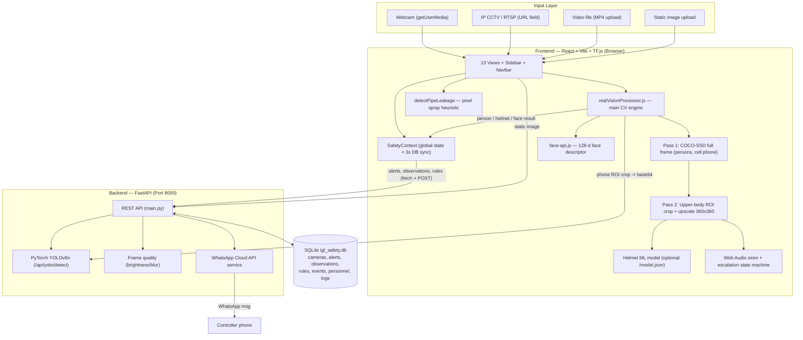
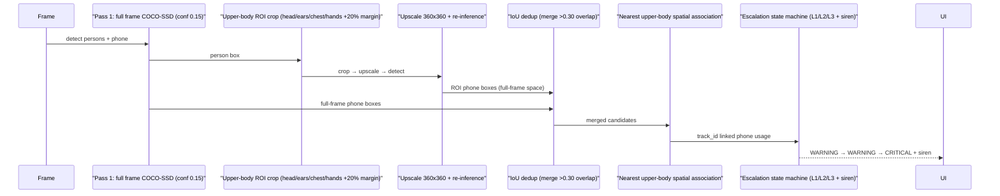

# 🛡️ IGL VisionGuard AI — Complete Project Guide (Hinglish)

> Ye document kisi bhi naye developer, reviewer, manager ya client ke liye hai.
> Ise padhne ke baad aapko poori tasveer mil jaayegi: **project kya hai, kya ban chuka hai, kaun sa part real hai, kaun sa demo hai, kya missing hai, aur aage kya hona chahiye.**
>
> Last updated: 20 Nov 2026 · Project version: 1.0.0

---

## 0. Ek Nazar Mein (TL;DR)

| Cheez | Detail |
|---|---|
| **Project naam** | IGL VisionGuard AI — Industrial AI Safety Intelligence System |
| **Ek line mein** | Factory/refinery/conveyor plant ke liye real-time AI camera monitoring + safety alerting + packaging quality inspection ka web dashboard |
| **Frontend** | React 18 + Vite 5 + Tailwind 4, TensorFlow.js (COCO-SSD), face-api.js |
| **Backend** | Python FastAPI + Uvicorn, PyTorch YOLOv8 (ultralytics), SQLite3 |
| **Database** | `backend/igl_safety.db` (SQLite, WAL mode), 10 tables |
| **Kahan chalta hai** | Browser me AI inference (TFJS) + local FastAPI server; koi cloud service mandatory nahi |
| **Modules (Sidebar)** | 13 modules — Dashboard, Camera Setup, Live Monitoring, Expected Personnel, Packaging Inspection, Pipe Inspection & Scanner, Personnel Schedule, Safety Events, Near Miss, Incidents, Analytics, Camera & AI Health, Configuration |
| **Real kya hai** | Live camera person detection, mobile-phone detection (2-pass + backend YOLO), face recognition, alerts DB, rules DB, WhatsApp notification, pipe leakage heuristic, image scanner |
| **Demo/simulated kya hai** | Packaging Inspection (random bottles), Near-Miss radar (manual slider), RealInputBanner ke demo buttons |
| **Biggest missing** | Custom helmet ML model files, real CCTV/RTSP stream support, authentication, packaging ka real hardware, tests |

---

## 1. Project kis problem ko solve karta hai

Manufacturing plant, refinery, packaging line aur hazardous work zones mein safety incidents (helmet nahi pehna, mobile use karna, restricted area mein ghusna, forklift ke paas jaana) manually monitor karna mushkil hai. IGL VisionGuard AI ka maqsad hai:

1. **Camera feed ko real-time analyse karna** aur violation detect hote hi alert + photo evidence banana.
2. **Sab alerts ek database mein store karna** (SQLite) taki audit trail rahe — kab, kahan, kitna confidence, kisne acknowledge/resolve kiya.
3. **Rules define karna** — kaunsa camera, kaunsa area, kis time window mein kitne log hone chahiye.
4. **WhatsApp par controller ko alert bhejna** (unknown person / expected personnel mismatch).
5. **Conveyor packaging quality** — bottle fill level, cap integrity, body defect ka demo inspection screen.
6. **Camera health diagnostics** — dark/blurry/blocked camera par "NOT ASSESSABLE" dikhana, taaki false green signal na mile.

Design philosophy ka core rule (code mein clearly likha hai):

> **"Agar camera dekh nahi paa raha, to system ko 'SAFE' nahi bolna chahiye — 'NOT ASSESSABLE' bolna chahiye."**
> Isi liye frame quality check (brightness + blur) har detection se pehle chalta hai.

---

## 2. Kaun use karega (Users / Personas)

| User | Kaam |
|---|---|
| Plant Safety Officer / HSE Manager | Live monitoring, alerts acknowledge/resolve, evidence dekhna |
| Shift In-charge / Control Room | WhatsApp alerts, person count verification, near-miss radar |
| QA / Production Engineer | Packaging inspection reports, reject log |
| Plant Manager / Client (demo) | Dashboard KPIs, analytics, presentations |
| Developer | Code extend karna — naya detection module, naya camera source, naya alert type |

---

## 3. High-Level Architecture



### Data flow ka short version

1. **Live monitoring flow:** Camera → browser `<video>` → TFJS inference (~150ms throttle) → canvas overlay (60 FPS render) → alert generate → `POST /api/alerts` → SQLite → har 3 second baad context refresh → Dashboard/Alerts/Analytics update.
2. **Backend YOLO flow:** Browser person ka upper-body crop banata hai → base64 → `POST /api/yolo/detect` → PyTorch YOLOv8n inference → detections wapas → frontend IoU merge + spatial association.
3. **Static image flow:** User image upload karta hai (Pipe Inspection / Image-Scanner) → quality check → leakage/objects analysis → result UI par.

---

## 4. Tech Stack (exact versions)

### Frontend (`frontend/package.json`)

| Type | Package | Version | Kaam |
|---|---|---|---|
| UI | `react`, `react-dom` | ^18.2.0 | UI library |
| Build | `vite` | ^5.1.6 | Dev server + bundler |
| Build | `@vitejs/plugin-react` | ^4.2.1 | React fast refresh |
| Styling | `tailwindcss` + `@tailwindcss/postcss` | ^4.3.3 | Utility CSS |
| CV | `@tensorflow/tfjs` | ^4.22.0 | Browser ML runtime |
| CV | `@tensorflow-models/coco-ssd` | ^2.2.3 | Person / cell-phone object detection |
| Face | `@vladmandic/face-api` | ^1.7.15 | Face detect + 128-d descriptor |
| Icons | `lucide-react` | ^0.344.0 | Icons |

### Backend (`backend/requirements.txt`)

| Package | Version | Kaam |
|---|---|---|
| `fastapi` | >=0.110,<1.0 | REST API |
| `uvicorn[standard]` | >=0.28 | ASGI server |
| `pydantic` | >=2.6 | Request validation |
| `ultralytics` | >=8.1 | YOLOv8 PyTorch inference |
| `opencv-python` | >=4.9 | Image decode / resize |
| `numpy` | >=1.26 | Array ops |
| `python-multipart` | >=0.0.9 | File upload support |
| `requests` | >=2.31 | WhatsApp HTTP calls |
| `python-dotenv` | >=1.0 | `.env` loading |

### Models present in repo

| Model | Location | Size / Status |
|---|---|---|
| YOLOv8 nano weights | `backend/yolov8n.pt` | ~6.4 MB, **present** |
| Face detector + landmark + recognition | `frontend/public/models/face-api/*.bin` | **present** |
| Custom helmet model | `frontend/public/models/helmet/model.json` | ❌ **MISSING** |

---

## 5. Repository Structure (file-by-file)

```
IGL/
├── README.md                       # Setup, features, env vars, deployment guide
├── .gitignore                      # node_modules, venv, .env, *.db, dist ignore
├── .dist/                          # (empty) unused folder
│
├── backend/
│   ├── main.py                     # ★ FastAPI app — saare 30+ REST endpoints
│   ├── database.py                 # SQLite schema + init + seed
│   ├── ai_engine.py                # Frame quality, point-in-polygon, distance math
│   ├── whatsapp_service.py         # Meta WhatsApp Cloud API (mock + live mode)
│   ├── debug_yolo_phone.py         # CLI diagnostic: image par phone detect test
│   ├── test_yolo_api.py            # Automated API test (running server chahiye)
│   ├── yolov8n.pt                  # YOLOv8 nano weights
│   ├── igl_safety.db               # Local SQLite DB (gitignored, current data)
│   ├── .env.example                # Backend config template
│   ├── requirements.txt            # Python deps
│   └── .venv/                      # Local virtualenv (gitignored)
│
├── frontend/
│   ├── package.json / package-lock.json
│   ├── vite.config.js              # port 3000, host: true
│   ├── tailwind.config.js / postcss.config.js
│   ├── index.html
│   ├── .env.example                # VITE_API_BASE
│   ├── public/models/face-api/     # Face-API weights
│   └── src/
│       ├── main.jsx                # React entry
│       ├── App.jsx                 # Tab routing (kaunsa view kab dikhega)
│       ├── index.css               # Tailwind + glass-panel styles
│       ├── components/
│       │   ├── Sidebar.jsx         # 13 module navigation
│       │   ├── Navbar.jsx          # Top bar + connection status
│       │   ├── RealInputBanner.jsx # "REAL SYSTEM RUNNING" + 5 demo buttons
│       │   └── EvidenceModal.jsx   # Photo evidence popup
│       ├── context/
│       │   └── SafetyContext.jsx   # ★ Global state + 3s backend polling + actions
│       ├── services/
│       │   ├── api.js              # ★ 30+ fetch wrappers (saare endpoints)
│       │   ├── realVisionProcessor.js   # ★★ Main CV engine (~46 KB)
│       │   ├── phoneDetectionProcessor.js # Backend YOLO phone detector wrapper
│       │   ├── packagingProcessor.js # Bottle inspection simulation logic
│       │   └── faceRecognition.js  # face-api load + descriptor + matching
│       └── views/
│           ├── DashboardView.jsx           # KPI dashboard
│           ├── CameraInputView.jsx         # Camera setup (webcam/RTSP/file/image)
│           ├── LiveMonitoringView.jsx      # ★ Live AI viewport (~61 KB)
│           ├── ExpectedPersonnelView.jsx   # Expected people + WhatsApp (~50 KB)
│           ├── PersonnelMonitoringView.jsx # Schedule rules + events (~47 KB)
│           ├── PackagingInspectionView.jsx # Conveyor demo (~30 KB)
│           ├── PipeInspectionView.jsx      # Pipe leakage + AI scanner (~61 KB)
│           ├── ImageCameraInspectionView.jsx # ⚠️ orphaned (App.jsx me import nahi)
│           ├── AlertsView.jsx              # Safety events table + evidence
│           ├── PersonnelAnomalyView.jsx    # Anomaly check + observations
│           ├── NearMissView.jsx            # Worker-vehicle distance radar (manual)
│           ├── CameraHealthView.jsx        # Lens/brightness diagnostics
│           ├── AnalyticsView.jsx           # Charts from backend
│           └── ConfigurationView.jsx       # Geofence + threshold sliders
│
└── docs_and_reports/
    ├── IGL_VisionGuard_AI_Workflow_Documentation.md
    ├── IGL_VisionGuard_AI_Workflow_Report.pdf
    ├── IGL_VisionGuard_AI_Presentation.html
    ├── IGL_VisionGuard_AI_Presentation.pptx   (14 slides)
    └── IGL_VisionGuard_AI_COMPLETE_GUIDE.md   (← yeh file)
```

---

## 6. Backend Detail

### 6.1 FastAPI app (`main.py`)

- CORS: `ALLOWED_ORIGINS` env se (default localhost:3000 + 5173).
- Startup: `init_database()` — saare tables + indexes banata hai.
- YOLO model **lazy load** hota hai (pehli `/api/yolo/detect` call par).
- Image size limits: max dimension + max pixels + max payload bytes (DoS protection).

### 6.2 Complete API list

| # | Method | Endpoint | Kaam |
|---|---|---|---|
| 1 | GET | `/` | Health/info |
| 2 | GET | `/api/dashboard/stats` | KPI counts (alerts, cameras, violations, etc.) |
| 3 | GET | `/api/cameras` | Camera list |
| 4 | POST | `/api/cameras` | Camera register |
| 5 | PUT | `/api/cameras/{id}/status` | Online/offline/not-assessable update |
| 6 | POST | `/api/process-frame` | Base64 frame quality check (brightness/blur) |
| 7 | POST | `/api/yolo/detect` | ★ PyTorch YOLOv8 object detection |
| 8 | GET | `/api/alerts` | Alerts list (filters) |
| 9 | POST | `/api/alerts` | ★ Alert create (with base64 evidence) |
| 10 | PUT | `/api/alerts/{id}/acknowledge` | Alert acknowledge |
| 11 | PUT | `/api/alerts/{id}/resolve` | Alert resolve + notes |
| 12 | GET | `/api/observations` | Track observations |
| 13 | POST | `/api/observations` | Observation record |
| 14 | POST | `/api/personnel/check-anomaly` | Feature-vector based personnel anomaly |
| 15 | GET | `/api/restricted-zones` | Geofence zones |
| 16 | POST | `/api/restricted-zones` | Zone create (polygon coords) |
| 17 | GET | `/api/analytics` | Analytics summary |
| 18 | GET | `/api/personnel-monitoring/rules` | Schedule rules |
| 19 | POST | `/api/personnel-monitoring/rules` | Rule create |
| 20 | PUT | `/api/personnel-monitoring/rules/{id}` | Rule update |
| 21 | DELETE | `/api/personnel-monitoring/rules/{id}` | Rule delete |
| 22 | GET | `/api/personnel-monitoring/events` | Schedule events |
| 23 | POST | `/api/personnel-monitoring/events` | Event create (auto WhatsApp) |
| 24 | PUT | `/api/personnel-monitoring/events/{id}/acknowledge` | Event ack |
| 25 | PUT | `/api/personnel-monitoring/events/{id}/resolve` | Event resolve |
| 26 | GET | `/api/expected-personnel/rules` | Expected-person rules |
| 27 | POST | `/api/expected-personnel/rules` | Rule create |
| 28 | PUT | `/api/expected-personnel/rules/{id}` | Rule update |
| 29 | DELETE | `/api/expected-personnel/rules/{id}` | Rule delete |
| 30 | GET | `/api/notifications/whatsapp/status` | WhatsApp mode/status |
| 31 | POST | `/api/notifications/whatsapp/test` | Test WhatsApp message |
| 32 | POST | `/api/notifications/whatsapp/send` | Unknown-person WhatsApp alert |
| 33 | GET | `/api/notifications/logs` | Notification logs |
| 34 | GET | `/api/registered-personnel` | Registered employees |
| 35 | POST | `/api/registered-personnel` | Employee add (+face descriptors) |
| 36 | PUT | `/api/registered-personnel/{id}` | Employee update |
| 37 | DELETE | `/api/registered-personnel/{id}` | Employee delete |
| 38 | GET | `/docs`, `/redoc`, `/openapi.json` | Swagger / ReDoc / schema |

> Note: Swagger UI `http://127.0.0.1:8000/docs` par khul jaata hai — API test karne ka sabse aasaan tareeka.

### 6.3 Database schema (10 tables)

| Table | Purpose | Important columns |
|---|---|---|
| `cameras` | Registered camera streams | id, name, source_type (webcam/rtsp/file), source_url, status, fps, latency_ms, brightness, blur_score, resolution |
| `restricted_zones` | Geofence polygons | camera_id, zone_name, polygon_coords (JSON), risk_level |
| `observations` | Detected object tracks | track_id, camera_id, zone_name, object_type, bounding_box, feature_vector, confidence |
| `alerts` | ★ Safety alerts | id, event_type, camera_id/name, zone_name, severity, status, confidence, evidence_image_base64, metadata_json, detected_at, acknowledged_at/by, resolved_at/by |
| `health_logs` | Camera/model health events | camera_id, event_type (DISCONNECT / NOT_ASSESSABLE / MODEL_UNAVAILABLE / STREAM_RECOVERY), details |
| `personnel_monitoring_rules` | Schedule rules | camera_id, area_id, schedule_date, start_time, end_time, expected_person_count, verification_duration, cooldown, enabled |
| `personnel_monitoring_events` | Rule violation events | rule_id, expected/observed/additional count, status, evidence, track_ids |
| `expected_personnel_rules` | Expected headcount rules | rule_name, zone_name, camera_id, start/end time (overnight support), expected count, cooldown, controller_whatsapp, whatsapp_enabled |
| `notification_logs` | WhatsApp/SMS/email logs | event_id, channel, recipient, status (SIMULATED/SUCCESS/FAILED), provider_message_id, message_text, error_message |
| `registered_personnel` | Employee roster + face data | id (EMP-101), track_id, name, designation, department, face_descriptors (JSON 128-d vectors) |

**Current DB data (aaj ki state):**

```
cameras = 0, restricted_zones = 0, observations = 0, alerts = 0,
health_logs = 0, personnel_monitoring_rules = 1,
personnel_monitoring_events = 0, expected_personnel_rules = 1,
notification_logs = 0, registered_personnel = 2
```

Matlab: schema ready hai, lekin real usage data almost empty hai (sirf 1-1 demo rule + 2 demo employees).

### 6.4 Backend config (`.env`)

| Variable | Default | Kaam |
|---|---|---|
| `ALLOWED_ORIGINS` | localhost:3000, 5173 | CORS |
| `DATABASE_PATH` | `igl_safety.db` | SQLite file |
| `YOLO_MODEL_PATH` | `yolov8n.pt` | YOLO weights |
| `WHATSAPP_MODE` | `mock` | `mock` ya `live` |
| `WHATSAPP_ACCESS_TOKEN` | — | Meta token |
| `WHATSAPP_PHONE_NUMBER_ID` | — | Meta phone number ID |
| `CONTROLLER_WHATSAPP_NUMBER` | — | Recipient (e.g. +91…) |
| `WHATSAPP_API_VERSION` | `v18.0` | Graph API version |
| `WHATSAPP_USE_TEMPLATE` | `false` | Template message ya plain text |
| `WHATSAPP_TEMPLATE_NAME` | `igl_unknown_person_alert` | Template name |

---

## 7. Frontend Detail

### 7.1 Tab routing (`App.jsx`)

| activeTab id | Component | Sidebar label |
|---|---|---|
| `dashboard` | DashboardView | Overview |
| `camera-input` | CameraInputView | Camera Setup |
| `live-monitoring` | LiveMonitoringView | Live Monitoring |
| `expected-personnel` | ExpectedPersonnelView | Expected Personnel |
| `personnel-monitoring` | PersonnelMonitoringView | Personnel Schedule & Monitoring |
| `pipe-inspection` **and** `image-camera-inspection` | PipeInspectionView | Pipe Inspection & Scanner |
| `packaging` | PackagingInspectionView | Packaging Inspection |
| `alerts` | AlertsView | Safety Events |
| `personnel` | PersonnelAnomalyView | Incidents |
| `near-miss` | NearMissView | Near Miss |
| `analytics` | AnalyticsView | Analytics |
| `camera-health` | CameraHealthView | Camera & AI Health |
| `config` | ConfigurationView | Configuration |

### 7.2 Global state (`SafetyContext.jsx`)

- **3 second polling** — `refreshBackendData()` har 3s chalta hai aur 11 endpoints parallel fetch karta hai (stats, alerts, cameras, observations, zones, personnel rules, personnel events, expected rules, WhatsApp status, notification logs, registered personnel).
- **State:** `activeTab`, `activeStream`, `streamSource`, `personCount`, `streamMetrics`, `stats`, `alerts`, `cameras`, `observations`, `restrictedZones`, `personnelRules`, `personnelEvents`, `registeredPersonnel`, `expectedPersonnelRules`, `whatsappStatus`, `notificationLogs`, `selectedEvidence`.
- **Actions:** `connectWebcam`, `connectRtsp`, `connectVideoFile`, `connectImageFile`, `disconnectStream`, `dispatchAlert`, `recordObservation`, `acknowledgeAlert`, `resolveAlert`, `addRestrictedZone`, personnel rule CRUD, expected-personnel rule CRUD, `registerPerson`, WhatsApp test/send, `playAlertSound` (Web Audio beep).

### 7.3 Vision engine (`realVisionProcessor.js`) — sabse important file

| Function | Kaam |
|---|---|
| `loadDetectionModel()` | COCO-SSD model browser me load |
| `detectObjectsAndMobilePhone()` | ★ Main per-frame detection: persons + phones + helmet + face |
| `detectHelmetForPerson()` | Head ROI crop → helmet model → `hasHelmet` (model na ho to `null`, safe default) |
| `analyzeFrameQuality()` | Brightness + blur (variance) → `isAssessable`, `notAssessableReason` |
| `isPointInPolygon()` | Zone breach check |
| `calculateBoxDistance()` | Proximity distance (normalized) |
| `extractBoxFeatureVector()` | RGB histogram — person re-identification ke liye |
| `captureCanvasSnapshot()` | Evidence image (base64) |
| `startSirenAlarm()` / `stopSirenAlarm()` | Web Audio siren (escalation level 3) |
| `detectPipeLeakage()` | ★ Pipe leak heuristic: bright spray pixels → grid clustering → consecutive frame confirmation |
| `loadHelmetDetectionModel()` | `/models/helmet/model.json` se custom TFJS model load (abhi file nahi hai) |

**Phone detection ka 2-pass architecture (core innovation):**



**Temporal persistence (flicker removal):**

- `HELMET_PERSISTENCE_FRAMES = 3`
- `HELMET_MISS_GRACE_FRAMES = 3`
- `TRACK_RETENTION_MS = 8000` (track memory buffer)
- Phone escalation: Level 1 (>=3 frames & >=2s) → Level 2 (after 4s) → Level 3 (after 4s, siren on)

### 7.4 Face recognition (`faceRecognition.js`)

- face-api.js: tiny face detector + 68 landmarks + 128-d recognition net.
- `captureFaceDescriptor()` — person ka face descriptor (128 floats) banata hai.
- `matchRegisteredFace()` — cosine/euclidean distance se registered personnel se match.
- Live monitoring me "Register Person" modal hai — face capture karke descriptor backend (`registered_personnel.face_descriptors`) me save hota hai.

---

## 8. Module-by-Module — kya kaam karta hai aur kaise

### M1. Overview Dashboard (`DashboardView.jsx`)
- KPI cards: active alerts, PPE violations, restricted breaches, near-miss, unrecognized personnel, total observations.
- "Live Plant Feed" status — camera connected hai ya nahi.
- Data source: backend `/api/dashboard/stats` (3s refresh).
- **Status:** Real (DB-driven).

### M2. Camera Setup (`CameraInputView.jsx`)
- 4 input modes: webcam, RTSP URL, video file (MP4), image.
- Mirror view toggle (horizontal flip).
- Frame quality inspector (brightness, blur, resolution, assessable ya nahi).
- **Status:** Webcam + file/image **real** hain. RTSP: URL save/register hota hai, lekin **browser directly RTSP stream nahi khol sakta** — ye actual playback ke liye backend/WebRTC gateway chahiye. (Ye ek known limitation hai.)

### M3. Live AI Monitoring (`LiveMonitoringView.jsx`) — ★ flagship module
- 60 FPS canvas render loop, alag se ~150ms throttled async TFJS inference (UI smooth rehti hai).
- Overlays: person boxes + track IDs (`TRK-P101`…), helmet status tag, phone boxes, proximity lines, restricted-zone polygons.
- Toggles: Show Boxes / Show Zones / Show Distances / Mirror.
- Phone warning escalation + siren.
- Live persons list + "Register Person" face enrollment.
- AI Debug Inspector (raw predictions, phone candidates, face status).
- Alert dispatch → backend alerts table.
- **Status:** Real. Sabse solid module.

### M4. Expected Personnel + WhatsApp (`ExpectedPersonnelView.jsx`)
- Rules: zone, camera, start/end time, expected count, verification duration, cooldown, controller WhatsApp.
- Do modes: **"Staged Prototype Simulator"** (default) aur **Live AI Stream** (webcam on karke).
- Live mode: person count detect → expected vs observed → mismatch par event + WhatsApp alert.
- WhatsApp message preview + status (SIMULATED/SUCCESS/FAILED) + notification logs.
- **Status:** Rules + events + WhatsApp **real** (mock mode default). Live counting real, par default simulator mode open hota hai.

### M5. Personnel Schedule & Monitoring (`PersonnelMonitoringView.jsx`)
- Rule create/edit/delete (camera, area, date, time window, expected count, duration, cooldown).
- Live stream par count verification → event create → WhatsApp.
- Event acknowledge/resolve.
- **Status:** Real (DB + backend). UI default me kuch demo-ish labels hain, par data flow real hai.

### M6. Packaging Inspection (`PackagingInspectionView.jsx`) — ⚠️ DEMO
- Animated conveyor belt + moving bottle graphics + scanner beam.
- Checks: fill level (LOW/PASS/HIGH), cap integrity (MISSING/MISALIGNED/DAMAGED/PASS), body/surface defect.
- Overall PASS/REJECT + air-jet ejector animation.
- Searchable inspection log with defect filter.
- **Status:** **100% simulation.** `packagingProcessor.js` ka `inspectBottle()` random defect generate karta hai. UI par saaf likha hai: "DEMO ONLY — NO REAL INSPECTION" aur "no camera, 3D depth sensor, trained model, conveyor, or reject actuator is connected". Koi hardware/API connected nahi.

### M7. Pipe Inspection & AI Scanner (`PipeInspectionView.jsx`)
- Live camera ya uploaded image par pipe leakage inspection.
- `detectPipeLeakage()`: image quality check → bright spray pixels detect → 8x6 grid me cluster density → spray ratio/spatial pattern → live camera par 4 consecutive frames confirmation → evidence region bbox + confidence.
- "UNABLE_TO_INSPECT" status jab image dark/blurry ho.
- Featured defect classes list (UI).
- **Status:** Real heuristic (rule-based CV, ML model nahi). Accuracy limited — spray pattern based hai, isliye "REVIEW_REQUIRED" status deta hai.

### M8. Safety Events / Alerts (`AlertsView.jsx`)
- Table: event type, zone, severity, confidence, timestamp, status.
- Filters: status + severity.
- Evidence modal (base64 screenshot).
- Acknowledge / Resolve (prompt se notes).
- **Status:** Real (backend CRUD).

### M9. Incidents / Personnel Anomaly (`PersonnelAnomalyView.jsx`)
- Anomaly check form: track_id + random feature vector bhej kar backend `/api/personnel/check-anomaly` hit karta hai.
- Observations table.
- **Status:** Real backend endpoint, lekin **frontend random test vector bhejta hai** — actual camera se linked nahi. Ye primarily demo/diagnostic screen hai. Sleeping-on-duty detection jaisa koi real pose model nahi hai (README/doc me mention hai, code me nahi).

### M10. Near Miss Radar (`NearMissView.jsx`) — ⚠️ SEMI-DEMO
- 2D radar screen: vehicle node + worker node, 2.0m danger boundary box.
- Distance slider se worker position move hoti hai (0.2m DANGER → 3.0m SAFE).
- Status badge: CRITICAL PROXIMITY BREACH / HIGH PROXIMITY RISK / SAFE DISTANCE OK.
- Alert dispatch karta hai (backend me save).
- **Status:** Radar UI aur math real hai, par **distance manually slider se aata hai — camera se auto-detect nahi hota.** Vehicle detection bhi nahi hai.

### M11. Analytics (`AnalyticsView.jsx`)
- Backend `/api/analytics` se incident distribution charts.
- Agar DB empty hai to "zero saved incidents" empty state.
- **Status:** Real (data na hone par khaali).

### M12. Camera & AI Health (`CameraHealthView.jsx`)
- Active stream ke metrics: FPS, brightness, blur score.
- "NOT ASSESSABLE" rules explain karta hai (too dark / dirty lens / disconnected).
- **Status:** Active stream ke context metrics dikhata hai; **registered cameras ki list ya `health_logs` table se data nahi leta** — multi-camera health view missing hai.

### M13. Configuration (`ConfigurationView.jsx`)
- Geofence polygon preview + zone name + "Save Dangerous Zone to Database" (real POST).
- Threshold sliders: PPE confidence, zone sensitivity, near-miss distance.
- **Status:** Zone save real; **sliders sirf local state hain — DB/config me persist nahi hote** (refresh par reset).

### M14. Extra: `ImageCameraInspectionView.jsx` — ⚠️ ORPHANED
- 59.7 KB ka alag "dual mode live camera + image upload" scanner.
- `App.jsx` me import **nahi** hai, sidebar me bhi nahi — **dead code**. Future me chahiye to explicitly wire karna padega.

---

## 9. Real vs Demo — Truth Table (sabse important section)

| Module | Real? | Kya real hai | Kya missing/demo hai |
|---|---|---|---|
| Dashboard | ✅ | DB stats, 3s refresh | — |
| Camera Setup | ⚠️ Partial | Webcam, file, image real | RTSP playback nahi (sirf URL register) |
| Live Monitoring | ✅✅ | Person detect, phone 2-pass, face recognition, alerts, siren | Helmet model files missing |
| Expected Personnel | ✅ | Rules, events, WhatsApp, live counting | Default "simulator" mode |
| Personnel Schedule | ✅ | Rule CRUD, events, ack/resolve | — |
| Packaging Inspection | ❌ Demo | Sirf UI + random data | Real camera, depth sensor, model, ejector — kuch nahi |
| Pipe Inspection | ⚠️ Heuristic | Spray-pixel leakage detection, quality gate | ML model nahi, rule-based |
| Alerts | ✅ | Full CRUD + evidence | Duplicate suppression nahi |
| Incidents / Anomaly | ⚠️ Partial | Backend anomaly endpoint | Frontend random test vector; sleeping detection nahi |
| Near Miss | ⚠️ Semi-demo | Radar math + alert save | Manual slider, koi camera/vehicle detect nahi |
| Analytics | ✅ | Backend charts | Data hi nahi hai abhi |
| Camera Health | ⚠️ Partial | Active stream metrics | Registered cameras / health_logs integrate nahi |
| Configuration | ⚠️ Partial | Zone DB save | Threshold sliders persist nahi hote |

---

## 10. Kaise Chalayein (Step-by-Step)

### Prerequisites
- Python 3.10+
- Node.js 18+ (20/24 recommended)
- Git

### Backend

```powershell
cd backend
python -m venv venv
venv\Scripts\activate          # Windows
# source venv/bin/activate     # Linux/macOS
pip install -r requirements.txt
copy .env.example .env         # Windows
# cp .env.example .env         # Linux/macOS
python -m uvicorn main:app --host 127.0.0.1 --port 8000 --reload
```

- API: http://127.0.0.1:8000
- Swagger: http://127.0.0.1:8000/docs

> Repo me `backend/.venv` already bana hua hai — Windows par seedha:
> `backend\.venv\Scripts\python.exe -m uvicorn main:app --host 127.0.0.1 --port 8000 --reload`

### Frontend

```powershell
cd frontend
npm install
copy .env.example .env
npm run dev
```

- App: http://localhost:3000

### Verify

```powershell
# Backend YOLO API test (server chalu hona chahiye)
cd backend
python test_yolo_api.py

# Frontend production build
cd frontend
npm run build
```

---

## 11. Kya Ban Chuka Hai (Completed)

1. ✅ FastAPI backend with 38+ REST endpoints + Swagger.
2. ✅ SQLite schema — 10 tables, indexes, JSON columns.
3. ✅ PyTorch YOLOv8n integration (`/api/yolo/detect`) — size validation + error handling ke saath.
4. ✅ Frame quality engine (brightness + blur) — "NOT ASSESSABLE" protection.
5. ✅ Browser-side TFJS COCO-SSD person detection + centroid tracker (TRK-P101+).
6. ✅ Two-pass mobile phone detection + IoU dedup + spatial association.
7. ✅ 3-tier warning escalation + Web Audio siren.
8. ✅ Face-api integration + employee registration (128-d descriptors) + matching.
9. ✅ Alerts lifecycle (create → acknowledge → resolve) + base64 evidence + modal.
10. ✅ Restricted zones (polygon) + point-in-polygon breach logic (frontend).
11. ✅ Personnel schedule rules CRUD + event generation + cooldown.
12. ✅ Expected personnel rules + WhatsApp Cloud API (mock + live) + notification logs.
13. ✅ Pipe leakage heuristic inspection (live camera + image).
14. ✅ Packaging inspection demo UI (clearly labeled as demo).
15. ✅ Near-miss radar UI + alert dispatch.
16. ✅ Analytics + Camera Health + Configuration screens.
17. ✅ 14-slide PPTX + PDF + HTML presentation + workflow documentation.
18. ✅ Production hardening: `.env.example`, CORS config, input size limits, `.gitignore`, README, deployment guide.

---

## 12. Kya Adhoora / Issues Hai (honest list)

| # | Issue | Kahan | Impact |
|---|---|---|---|
| 1 | **Helmet ML model files nahi hain** | `frontend/public/models/helmet/` missing; `realVisionProcessor.js:26` | Helmet detection hamesha `hasHelmet: null` → PPE helmet enforcement effectively off |
| 2 | **Packaging Inspection pura demo hai** | `packagingProcessor.js:37`, `PackagingInspectionView.jsx` | Real quality inspection claim nahi ki ja sakti |
| 3 | **Near-Miss radar camera se linked nahi** | `NearMissView.jsx:10-12` | Distance manual slider se; real vehicle/worker proximity nahi |
| 4 | **RTSP playback kaam nahi karta** | `CameraInputView` / `SafetyContext.connectRtsp` | Browser RTSP nahi dekh sakta; backend stream gateway chahiye |
| 5 | **Configuration sliders persist nahi hote** | `ConfigurationView.jsx:16-18` | Refresh par thresholds reset |
| 6 | **Camera Health me registered cameras list nahi** | `CameraHealthView.jsx` | Multi-camera health monitor missing; `health_logs` table unused |
| 7 | **Dead code / orphan view** | `ImageCameraInspectionView.jsx` (App.jsx import nahi) | 60 KB unused file, confusion |
| 8 | **Alert duplicates ka koi check nahi** | `main.py:446` `create_alert` | Same violation bar-bar DB me save ho sakta hai |
| 9 | **Demo alerts real alerts me mix ho jaate hain** | `RealInputBanner.jsx` | Banner "100% REAL INPUT (NO FAKE DATA)" kehta hai, par 5 demo buttons DB me alert daalte hain |
| 10 | **No authentication / authorization** | poore backend par | Koi bhi API hit kar sakta hai; production me risk |
| 11 | **Personnel Anomaly frontend random vector bhejta hai** | `PersonnelAnomalyView.jsx:32` | Real camera linkage missing |
| 12 | **Sleeping-on-duty / fire & smoke / fall detection** | sirf README me | Code me implement nahi |
| 13 | **Frontend tests nahi hain** | `frontend/` | Sirf `npm run build` verify hota hai |
| 14 | **Workflow documentation me purana schema** | `docs_and_reports/...Workflow_Documentation.md` | Code se mismatch (e.g. alerts table ka purana structure) |
| 15 | **Working tree dirty** | `frontend/package-lock.json` modified | Commit karna baaki |

---

## 13. Kya Hona Chahiye (Roadmap — priority order)

### P0 — Demo/production ke liye must
1. **Helmet model train ya source karo** → `frontend/public/models/helmet/model.json` + `weights_manifest` + `.bin` add karo. Tabhi PPE helmet detection real hoga.
2. **Alert dedup + rate limit** — same track_id + event_type ke liye cooldown (e.g. 30s) backend me. `alerts` table me `track_id` column add karo.
3. **Demo vs real data separation** — `is_demo` flag ya `source` field (`LIVE_CAMERA` / `DEMO_BUTTON` / `SIMULATOR`). Dashboard/Analytics me demo data filter ho.
4. **RTSP support** — backend me `ffmpeg` / `cv2.VideoCapture` based stream proxy ya WebRTC (aiortc) endpoint. Frontend `<video>` us stream ko play kare.
5. **Threshold persistence** — `ConfigurationView` ke sliders `config` table me save ho; backend detection me use ho.

### P1 — Product ko usable banane ke liye
6. **Authentication** — simple JWT login (safety officer/controller roles), protected API routes.
7. **Packaging inspection ko real banao** — ya to (a) camera + YOLO trained bottle/cap model, ya (b) clearly "SIMULATION ONLY" label har jagah (abhi partial hai).
8. **Near-miss auto detection** — vehicle (forklift) class detect karo (COCO me truck/car hai, forklift custom model), worker box se distance calculate karke alert.
9. **Camera Health multi-camera** — `/api/cameras` list + `health_logs` se real diagnostics grid.
10. **Persist config**: PPE threshold, zone sensitivity, near-miss distance — backend settings table.
11. **Report export** — PDF/Excel alert report (safety audits ke liye).
12. **Frontend tests** — Vitest + React Testing Library, kam se kam context aur api.js ke liye.

### P2 — Scale / polish
13. **PostgreSQL migration** (multi-user concurrent writes ke liye SQLite weak hai).
14. **WebSocket/SSE** — 3s polling ki jagah push updates (latency kam).
15. **Object tracking upgrade** — DeepSORT/ByteTrack (abhi centroid tracker hai).
16. **Helmet + vest + gloves multi-class PPE model**.
17. **Multi-camera grid view** + camera switching.
18. **Docker compose** — backend + frontend ek command me.
19. **CI/CD** — GitHub Actions: lint, build, test.
20. **Documentation sync** — workflow MD ko code ke saath update karo.

---

## 14. Risks & Security Notes

| Risk | Detail | Mitigation |
|---|---|---|
| No auth | Sab APIs public | JWT + role-based access |
| CORS | Sirf localhost allowed | Production domain add karo |
| Secrets | `.env` gitignored hai (sahi), par WhatsApp token leak na ho | Env vars / secret manager |
| Evidence images | Base64 DB me store hote hain → DB bloat | File storage + path reference |
| RTSP credentials | URL plain text DB me | Encrypt / env based |
| Demo data contamination | Demo alerts real reports me mix | `source` field |
| Browser dependency | TFJS inference GPU/CPU par depend | Web worker + model quantization |
| SQLite concurrency | Multi-user writes par lock | PostgreSQL |

---

## 15. Glossary (naye developer ke liye)

| Term | Matlab |
|---|---|
| **PPE** | Personal Protective Equipment — helmet, vest, gloves |
| **ROI** | Region Of Interest — image ka selected crop |
| **IoU** | Intersection over Union — do boxes ka overlap (0-1) |
| **COCO-SSD** | TensorFlow.js object detection model (80 classes) |
| **YOLOv8** | You Only Look Once — real-time object detection (Ultralytics/PyTorch) |
| **Track ID** | Person ko frames ke across follow karne wali unique ID (TRK-P101) |
| **Descriptor** | Face ka 128-number vector (face-api) |
| **NOT ASSESSABLE** | Camera quality kharab — system "safe" nahi bol sakta |
| **Escalation** | Warning ka level badhana (L1 → L2 → L3 + siren) |
| **Mock mode** | WhatsApp bina actual API call ke simulate karna |
| **Geofence / Restricted zone** | Map par polygon area jahan entry restricted hai |
| **Ejector** | Conveyor par reject bottle hataane wala air-jet |

---

## 16. Naye Developer ke liye Onboarding Checklist

**Day 1 — Setup**
- [ ] `git clone` → `backend/.venv` activate → `pip install -r requirements.txt`
- [ ] `copy .env.example .env` (backend) → `uvicorn main:app --reload`
- [ ] `http://127.0.0.1:8000/docs` khul raha hai? → API verify
- [ ] `cd frontend && npm install && npm run dev` → `localhost:3000`
- [ ] Camera Setup → Webcam connect → Live Monitoring me box dikh rahe?

**Day 2-3 — Code samjho**
- [ ] `SafetyContext.jsx` padho — saara global state + polling yahin hai
- [ ] `api.js` padho — har endpoint ka wrapper
- [ ] `realVisionProcessor.js` padho — CV ka dil (helmet/phone/quality)
- [ ] `main.py` padho — endpoints + DB
- [ ] `database.py` padho — schema

**Day 4-5 — Chhota feature banao**
- [ ] Naya alert type add karo (e.g. `GOGGLES_VIOLATION`) — DB enum + frontend badge
- [ ] Ek naya detection class add karo (COCO class se)
- [ ] Ek naya API endpoint + frontend button wire karo

**Pehle ye 3 cheezein karni hongi (kyunki abhi missing hain):**
1. Helmet model files
2. RTSP stream gateway
3. Authentication

---

## 17. Quick Reference — Important Files

| Chahiye | File |
|---|---|
| Saare API endpoints | `backend/main.py` |
| DB schema | `backend/database.py` |
| YOLO inference | `backend/main.py:336` (`/api/yolo/detect`) |
| WhatsApp logic | `backend/whatsapp_service.py` |
| Frame quality | `backend/ai_engine.py:13` + `frontend/src/services/realVisionProcessor.js:378` |
| Global state | `frontend/src/context/SafetyContext.jsx` |
| API client | `frontend/src/services/api.js` |
| CV engine | `frontend/src/services/realVisionProcessor.js` |
| Phone detector | `frontend/src/services/phoneDetectionProcessor.js` |
| Face recognition | `frontend/src/services/faceRecognition.js` |
| Routing | `frontend/src/App.jsx` |
| Navigation | `frontend/src/components/Sidebar.jsx` |
| Demo buttons | `frontend/src/components/RealInputBanner.jsx` |
| Presentation | `docs_and_reports/IGL_VisionGuard_AI_Presentation.pptx` |

---

*Ye guide project ke current code (commit `2ca6f79` tak) ke basis par bana hai. Code change hone par ise update karte rehna.*